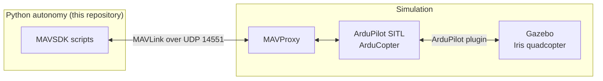

# Cued Interceptor

A Python autonomy stack for an ArduPilot multicopter, built and tested in simulation with Gazebo and MAVSDK.

> **Status:** work in progress. Everything here has been tested in simulation (ArduPilot SITL + Gazebo) only. Nothing in this repository has flown on a real vehicle.

## 1. Overview

The goal is a software stack where a ground sensor reports the position of a target and a drone flies to it automatically, with the flight logic written as code instead of flown by a pilot.

The project is built in stages. A drone is first flown in simulation, so mistakes cost nothing, and the same code can later be moved to a real vehicle on a companion computer. The current stage covers the foundation: connecting to the vehicle, reading telemetry, commanding flights, and monitoring health.

## 2. Project Objectives

- Integrate ArduPilot SITL with Gazebo simulation. *(done)*
- Communicate with the vehicle over MAVLink using MAVSDK. *(done)*
- Monitor telemetry and vehicle health. *(in progress)*
- Fly autonomous missions from Python. *(basic missions done)*
- Build a ground control application that cues the vehicle from ground-sensor input. *(planned)*
- Validate behaviour automatically in simulation with CI. *(planned)*

## 3. Features

**Implemented**

- Connection helper for MAVSDK over UDP
- Concurrent telemetry watchers (position, battery, armed state, flight mode) that report only on changes
- Scripted flight: wait until armable, arm, take off, land
- Go-to mission: fly 22 m north and return to the start position
- Battery decision logic (`OK`, `WARN`, `RETURN_HOME`, `LAND`, `UNKNOWN`) with unit tests

**Planned**

- Supervisor loop that acts on the battery decision, tested with a fake drone
- Detection of stale position data
- Mission state machine
- Guidance toward a moving target
- Ground control application and an ESP32 ground sensor
- Docker image for headless simulation and a GitHub Actions pipeline

## 4. System Architecture



- **Gazebo** simulates the physics, the world and the sensors.
- **ArduPilot SITL** is the real flight code, compiled to run on a PC. It receives the simulated sensor data and sends motor commands back through the ArduPilot Gazebo plugin.
- **MAVProxy** is the ground station that starts alongside SITL. It forwards the MAVLink stream to the UDP port the Python code listens on.
- **The Python code** connects through MAVSDK, in the same way a companion computer would connect to a real flight controller.

## 5. Technologies Used

| Technology | Purpose |
|---|---|
| Python 3.12 | Application development |
| asyncio | Concurrent telemetry and commands |
| ArduPilot (Copter SITL) | Flight controller software |
| Gazebo Harmonic | Vehicle simulation |
| MAVSDK-Python | Drone communication |
| MAVLink / MAVProxy | Communication protocol and ground station |
| Ubuntu 24.04 (WSL2) | Development environment |
| Git and GitHub | Version control |
| Pytest | Software testing |
| Docker, GitHub Actions | Headless simulation and CI *(planned)* |

## 6. Project Structure

```text
cued-interceptor/
├── src/
│   ├── connect.py       # connection helper
│   ├── telemetry.py     # concurrent telemetry watchers
│   ├── commands.py      # arm, take off, land
│   ├── goto.py          # fly 22 m north and return home
│   └── health.py        # battery decision logic
├── tests/
│   └── test_health.py   # unit tests for health.py
├── pytest.ini
├── requirements.txt
├── .gitignore
└── README.md
```

## 7. Requirements

- Ubuntu 24.04 (native or WSL2)
- Python 3.12
- ArduPilot with the SITL tools and MAVProxy
- Gazebo Harmonic (8.x)
- The [ardupilot_gazebo](https://github.com/ArduPilot/ardupilot_gazebo) plugin
- `mavsdk<4`

MAVSDK-Python 4.x changed its API. This project uses the earlier `System()` interface, so the version is pinned in `requirements.txt`. The warning printed on import is harmless.

## 8. Installation

**1. ArduPilot**

```bash
git clone --recurse-submodules https://github.com/ArduPilot/ardupilot.git ~/ardupilot
cd ~/ardupilot
Tools/environment_install/install-prereqs-ubuntu.sh -y
```

Open a new terminal afterwards so that `sim_vehicle.py` is on your `PATH`.

**2. Gazebo plugin**

```bash
sudo apt update
sudo apt install -y libgz-sim8-dev rapidjson-dev libopencv-dev \
  libgstreamer1.0-dev libgstreamer-plugins-base1.0-dev \
  gstreamer1.0-plugins-bad gstreamer1.0-libav gstreamer1.0-gl

git clone https://github.com/ArduPilot/ardupilot_gazebo ~/ardupilot_gazebo
cd ~/ardupilot_gazebo
export GZ_VERSION=harmonic
mkdir build && cd build
cmake .. -DCMAKE_BUILD_TYPE=RelWithDebInfo
make -j4
```

Add the plugin paths to `~/.bashrc`:

```bash
export GZ_SIM_SYSTEM_PLUGIN_PATH=$HOME/ardupilot_gazebo/build:$GZ_SIM_SYSTEM_PLUGIN_PATH
export GZ_SIM_RESOURCE_PATH=$HOME/ardupilot_gazebo/models:$HOME/ardupilot_gazebo/worlds:$GZ_SIM_RESOURCE_PATH
```

On WSL2, adding `export GALLIUM_DRIVER=d3d12` lets Gazebo use the GPU instead of rendering on the CPU.

**3. This project**

```bash
git clone https://github.com/Betofe/cued-interceptor.git
cd cued-interceptor
pip install -r requirements.txt
pip install pytest
```

## 9. Usage

Use three terminals.

**Terminal 1: Gazebo world**

```bash
gz sim -v4 -r iris_runway.sdf
```

**Terminal 2: ArduPilot SITL and MAVProxy**

```bash
sim_vehicle.py -v ArduCopter -f gazebo-iris --model JSON --console --out 127.0.0.1:14551
```

`--out` forwards the MAVLink stream to the UDP port the Python scripts listen on. If a script waits without printing `Connected`, type `output add 127.0.0.1:14551` in the MAVProxy terminal.

**Terminal 3: run a script**

```bash
python3 src/telemetry.py   # print telemetry as it changes
python3 src/commands.py    # arm, take off, land
python3 src/goto.py        # fly 22 m north, then return to the start
```

## 10. Testing

```bash
pytest
```

The tests cover the battery decision logic, including the exact threshold boundaries and an unknown (NaN) reading.

If ROS 2 is sourced in your terminal, its pytest plugin can crash pytest on startup. Disable plugin autoloading for the run:

```bash
PYTEST_DISABLE_PLUGIN_AUTOLOAD=1 pytest
```

### Design note: testable decisions

The battery logic is kept in a pure function (`health.battery_action`) that takes a percentage and returns an action. It knows nothing about the drone, so it can be tested with plain numbers and needs no simulator. The MAVSDK loop that reads the battery and acts on the result is a separate layer.

On a real aircraft, ArduPilot's own battery failsafe (the `BATT_*` parameters) remains the primary protection. The companion-computer logic is a second layer that supervises and reports.

## 11. Development Roadmap

- [x] ArduPilot SITL and Gazebo environment
- [x] MAVSDK connection and concurrent telemetry
- [x] Scripted takeoff, go-to and return home
- [x] Battery decision logic with unit tests
- [ ] Supervisor loop with a fake drone for tests
- [ ] Stale-position detection
- [ ] Mission state machine and logging
- [ ] Guidance toward a moving target
- [ ] Ground control application
- [ ] ESP32 ground sensor over Wi-Fi
- [ ] Docker image for headless simulation
- [ ] GitHub Actions pipeline running simulation scenarios
- [ ] Link-loss and network-degradation tests
- [ ] Post-flight log analysis

## 12. Author

**Imami Joel Betofe**

Mechatronics Engineer | Flight Control Engineer

Portfolio: https://betofe.github.io/
